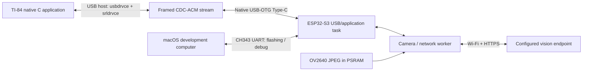

# TI-84 Plus CE Python AI Vision Terminal

A native TI-84 Plus CE application paired with ESP32-S3 camera firmware. The calculator provides a text interface; the ESP32-S3 captures an OV2640 JPEG and can send it over Wi-Fi to a configured HTTPS vision service. The calculator-to-ESP32 connection uses **native USB-OTG CDC-ACM**.

> **Development status: software builds and automated tests have passed. Physical calculator-to-ESP32 communication, the actual camera GPIO mapping, and USB power/VBUS compatibility have not been verified.** This is an implemented software prototype awaiting hardware bring-up. Compilation does not establish a working physical system.

The native ESP USB-OTG port carries calculator traffic. The separate **CH343 USB-UART port** is reserved for flashing and debugging. **Do not connect or power both ports simultaneously until the board's power arrangement and isolation are confirmed.**

## Hardware requirements

- TI-84 Plus CE Python calculator, targeting OS **5.8.0.0022**.
- ESP32-S3-WROOM CAM development board with **N16R8** memory configuration: 16 MB flash and 8 MB PSRAM.
- OV2640 camera, native USB-OTG Type-C port and separate CH343 USB-UART Type-C port.
- Mini-USB host/OTG adapter (Mini-USB male to USB-A female) and USB-A to USB-C **data** cable.
- macOS development computer; a 2.4 GHz Wi-Fi network and credentials for the selected vision service when enabling network features.

N16R8 identifies memory capacity, **not a PCB pinout**. No manufacturer or clone pin map is assumed to match the actual board. The microSD slot is unused. The existing adapter and supply still require electrical verification; no additional hardware purchase is assumed.

## System architecture



The calculator sends commands and retrieves bounded text replies. USB polling and camera/network work use separate tasks. A Mac-only diagnostic command can retrieve a captured JPEG for inspection; the calculator displays text only. No large vision-language model runs locally.

See the cited [feasibility assessment](docs/FEASIBILITY.md) and [architecture design](docs/ARCHITECTURE.md).

## Implemented features

- Native calculator menu: **Capture Image**, **Ask About Image**, **View Response**, **Connection Status** and **Settings**.
- Editable questions, 40-column text wrapping, line scrolling and 16-line pagination.
- Individual PING/PONG and 100-round calculator USB diagnostics.
- Shared C frame codec with lengths, sequence numbers, CRC-16, stream recovery and bounded buffers.
- Calculator USB host integration using the real `usbdrvce` / `srldrvce` APIs, deferred serial opening and explicit CDC DTR/RTS setup.
- ESP-IDF native USB CDC device firmware, request handling, disconnect/session handling and worker queues.
- Camera abstraction with JPEG retention, size/marker validation, stale-image invalidation and explicit pin-verification checks.
- Wi-Fi station connection, bounded retries, time synchronization and HTTPS with certificate/hostname verification.
- Configurable **Anthropic Messages-compatible** image requests and bounded text-response parsing.
- Mac CDC diagnostics for PING, status, corruption recovery, capture, questions, text retrieval and JPEG export.
- Software tests, prior validation evidence and step-by-step hardware acceptance procedures.

These features are implemented in source. Camera, network and end-to-end behavior have not been demonstrated on the physical hardware.

## Current development status

The original validation and the pre-publication rerun passed:

- **CEdev v15.0 calculator compile/link.**
- **ESP-IDF v5.4.2 ESP32-S3 base compile/link.**
- **All-module compile/link**, including camera, Wi-Fi, HTTPS and USB; compile-check mode refuses hardware operation.
- **266,787 C framing/fragmentation/corruption cases**, plus CRC/golden-frame and noise/bounds checks under AddressSanitizer and UndefinedBehaviorSanitizer.
- **Three Python tests** covering C/Python CRC agreement and host framing/recovery.

Read [original validation](evidence/VALIDATION.md) and [pre-publication validation](evidence/publication/VALIDATION.md) for actual commands, warnings, logs and artifact hashes. **No physical hardware or live API success is claimed.**

## Repository layout

```text
common/                 Allocation-free C framing and CRC
calculator/             Native CEdev application and makefile
firmware/
  main/                 USB/application, camera, Wi-Fi and HTTPS modules
  config/               Empty configuration templates and compile-only references
  dependencies.lock     Exact resolved ESP component versions/hashes
  sdkconfig*.defaults   Base and compile-check build settings
host/                   Real USB CDC diagnostic client
tests/                 C codec and Python cross-checks
tools/                 Software test runner and repository audit
docs/                  Feasibility, architecture, setup, hardware, API and tests
evidence/              Preserved original and pre-publication software evidence
```

Generated programs, object files, SDK downloads, build directories, caches and credentials are excluded from Git. Existing local build outputs are retained; regenerate them using the commands below.

## Installation and builds on macOS

Full instructions and troubleshooting are in [SETUP.md](docs/SETUP.md). Start from this repository's root in Terminal. Install Apple's command line developer tools if necessary (`xcode-select --install`), then create isolated build tooling:

```sh
mkdir -p .tools
python3 -m venv .tools/build-env
.tools/build-env/bin/pip install cmake ninja
export PATH="$PWD/.tools/build-env/bin:$PATH"
```

### TI-84 calculator setup

1. Back up calculator variables.
2. Install [CEdev **v15.0**](https://github.com/CE-Programming/toolchain/releases/tag/v15.0) for your Mac's ARM or Intel architecture; copy `CEdev` into `.tools/CEdev`.
3. Build the application:

   ```sh
   export PATH="$PWD/.tools/CEdev/bin:$PATH"
   make -C calculator
   ```

4. For OS **5.8.0.0022**, follow the maintainer's [arTIfiCE instructions](https://yvantt.github.io/arTIfiCE/) using the **v2.1** route for CE OS <=5.8.4. Current v3 targets OS 5.8.5. Native execution on the actual unit remains a hardware acceptance step; no OS upgrade or downgrade is required by this project.
5. Use [TI Connect CE](https://education.ti.com/en/products/computer-software/ti-connect-ce-sw) to transfer `calculator/bin/TIVISION.8xp` and the matching [CE runtime libraries v15.0](https://github.com/CE-Programming/libraries/releases/tag/v15.0). Launch through the OS-appropriate native-code route. Test a basic native hello-world first if needed.

CLEAR exits the application. Settings and answers are held in RAM. Stock calculator Python is not treated as an arbitrary USB serial host API.

### ESP32-S3 firmware setup

Install the pinned SDK and load it into the current shell:

```sh
git clone --branch v5.4.2 --depth 1 --recursive https://github.com/espressif/esp-idf.git .tools/esp-idf
export IDF_TOOLS_PATH="$PWD/.tools/idf-tools"
.tools/esp-idf/install.sh esp32s3
export IDF_COMPONENT_CACHE_PATH="$PWD/.tools/component-cache"
. .tools/esp-idf/export.sh
cd firmware
idf.py set-target esp32s3
idf.py build
```

Keep `dependencies.lock`; the Espressif TinyUSB wrapper is pinned to **1.7.6~1**. Do not substitute newer APIs without revalidation. Restricted environments may need the component-manager version described in [SETUP.md](docs/SETUP.md).

With **native USB unplugged**, identify the CH343 UART port and flash through it:

```sh
idf.py -p /dev/cu.YOUR_CH343_PORT flash monitor
```

The default firmware deliberately logs a power-verification gate and does not install application USB. Complete [HARDWARE.md](docs/HARDWARE.md), then use `idf.py menuconfig` to acknowledge the verified power/adapter arrangement. Keep camera/network off for the first PING test. Disconnect CH343 before native USB testing unless dual-port isolation is already verified.

To compile/link every module **without operating hardware**, use a separate configuration from `firmware/`:

```sh
idf.py -B build-check -DIDF_TARGET=esp32s3 -DSDKCONFIG=sdkconfig.check -DSDKCONFIG_DEFAULTS="sdkconfig.defaults;sdkconfig.compilecheck.defaults" build
```

Do not flash the compile-check variant as a functional hardware test.

### Camera, Wi-Fi and API configuration

Only after physical calculator PING/PONG passes:

1. Copy `firmware/config/board_pins.example.h` to ignored `board_pins.h`. Enter independently verified camera nets and their evidence before setting `TV_BOARD_PINS_VERIFIED=1`.
2. Acknowledge the USB milestone and enable camera in menuconfig; build and test capture before enabling networking.
3. Copy `firmware/config/local_config.example.h` to ignored `local_config.h`; configure Wi-Fi, HTTPS endpoint, API key, model and API version privately.
4. Enable network support, rebuild, then test a real scene with **Capture Image → Ask About Image → View Response**.

The unverified Freenove reference is never selected for an ordinary operational build. Compile-only dummy strings are not credentials. The API adapter implements a documented provider format; another provider requires a separate serializer/parser, not just a different URL. See [API.md](docs/API.md). Firmware binaries containing credentials must remain private and are not committed.

### Automated tests and Mac USB diagnostics

From repository root:

```sh
sh tools/test.sh
python3 -m venv .venv
.venv/bin/pip install -r host/requirements.txt
.venv/bin/python -m serial.tools.list_ports -v
.venv/bin/python host/terminal.py /dev/cu.YOUR_NATIVE_CDC_PORT ping --count 100
.venv/bin/python host/terminal.py /dev/cu.YOUR_NATIVE_CDC_PORT status
.venv/bin/python host/terminal.py /dev/cu.YOUR_NATIVE_CDC_PORT corruption
```

The last commands require a physically connected native CDC device and a verified power arrangement. **They were not run against hardware during software validation.** CH343 is not the native application CDC port.

## USB communication protocol

Version 1 uses a byte stream with little-endian multibyte fields:

```text
"TV" | version:u8 | type:u8 | sequence:u16 | length:u16 | payload | crc:u16
```

Payloads are limited to **240 bytes**, frames to 250 bytes. CRC-16/CCITT-FALSE covers the version through payload. Successful replies echo the sequence and use `request_type | 0x80`; type `0xFF` carries a bounded diagnostic. PING sends a **framed** `PING` and expects `PONG`; plain terminal text is not a valid request.

Commands are PING (01), STATUS (02), CAPTURE (03), ASK (04), RESULT (05), and Mac-only JPEG retrieval (06). Text is fetched by checked offsets in chunks, up to 8192 bytes total. Invalid versions, lengths and CRCs are rejected; partial frames expire after 2 seconds. Capture/API requests are not automatically retried. See [PROTOCOL.md](docs/PROTOCOL.md) for exact descriptors, fields, timeouts and recovery behavior.

## Hardware testing checklist

Every item remains pending until measured on the actual equipment:

- [ ] Back up the calculator and verify native launch on OS 5.8.0.0022.
- [ ] Verify adapter ID grounding, data continuity, calculator host/A role and host VBUS.
- [ ] Establish adequate supply/current budget and safe VBUS/isolation before attaching the ESP.
- [ ] Verify Mac-to-ESP native CDC PING, malformed-frame recovery and reconnect behavior.
- [ ] Verify **TI-to-ESP** PING/PONG, 100 rounds, timeout handling and repeated reconnects.
- [ ] Verify actual camera GPIO mapping, connector orientation, sensor identity and PSRAM.
- [ ] Capture and inspect real JPEGs; confirm freshness, stability and responsive USB during work.
- [ ] Verify Wi-Fi, time/TLS, actual provider output and failure/oversized-response behavior.
- [ ] Check long-answer reconstruction, scrolling, pagination, editing and clean exit on-device.

Follow [TESTING.md](docs/TESTING.md) for precise procedures and stop conditions. A Mac USB result does not replace the calculator test. **Do not connect or power both board USB ports simultaneously until isolation is confirmed.**

## Known limitations and unverified functionality

- No physical calculator-to-ESP32 USB interoperability result exists yet. Both upstream stacks and the chosen CDC descriptor pairing still require device testing.
- Actual camera pins and USB power compatibility are unknown. No clone-board mapping or calculator current capacity is assumed.
- Native-code launch compatibility is supported by upstream documentation; execution on this individual calculator is pending.
- Camera, Wi-Fi, HTTPS and real AI replies have compile/link evidence only. No live network/provider or hardware test is claimed.
- Compile-check and default power-gated firmware intentionally refuse operation. Operational features must pass the documented hardware gates.
- Application deadlines do not prove that all upstream USB control/enumeration calls are bounded. CLEAR cancels a local wait; it does not cancel an ESP/provider operation.
- Text is ASCII with replacements for unsupported characters; prompts are 240 bytes and answers 8192 bytes. Settings/results are not persistent.
- The API adapter supports Anthropic Messages-compatible endpoints. TLS trust and valid device time are required; redirects and automatic paid-request retries are disabled.
- No image display, local VLM, Bluetooth transport or alternative calculator link is implemented.

## Repository hygiene and licensing

Before committing, stage the intended files and run:

```sh
python3 tools/check_repository.py
```

The audit checks staged content for credential patterns, nonempty secret configuration, personal paths/contact data and generated artifacts. It is a targeted automated check, not a guarantee against every possible secret format. Keep real `local_config.h`, board configuration, `.env` files and all generated firmware out of version control.

Original project source uses the [MIT license](LICENSE). Dependencies retain their own licenses; see [THIRD_PARTY.md](THIRD_PARTY.md). Upstream tools, calculator OS files, arTIfiCE and CE shared-library downloads are obtained separately.
