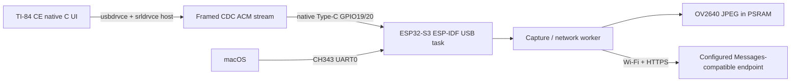

# Architecture and staged implementation

The calculator sends requests, the ESP returns bounded replies. One request is outstanding at a time. PING is handled by the USB task even while a worker captures or waits for HTTPS. Capture retains one JPEG; Ask uses that JPEG and a user prompt. No image crosses to the calculator. A bounded text result is retrieved in explicit chunks by offset, so the calculator controls pacing. Settings on TI contain prompt/timeout preferences only; secrets are provisioned in an ignored build-local header and never sent over CDC.

Phase 1 is the cited feasibility assessment. Phase 2 builds CDC PING/PONG on both devices, with connection status, stream recovery and deadlines. Camera and Wi-Fi default off. Phase 3 is opt-in only with an identified board header and passed hardware USB milestone. Phase 4 adds Wi-Fi and a documented provider adapter with TLS verification and bounded responses. Phase 5 exposes Capture, Ask, Response, Status and Settings on TI. Phase 6 captures actual build and test evidence separately from future hardware procedures.

The shared C codec has no OS dependencies. Endpoints perform partial reads/writes correctly. The calculator pumps USB during menus, editing and waits. `srl_Open` is deferred out of callbacks; disconnect invalidates pending handles and transfer state. USB enumeration/control transfer internals can still block inside the experimental upstream stack: application deadlines do not prove those library calls are bounded.

No hidden Wi-Fi/Bluetooth calculator transport, local VLM, mock camera, fabricated answer, or simulation is used. Optional modules may be compiled before hardware access, but must not be represented as hardware verified.
